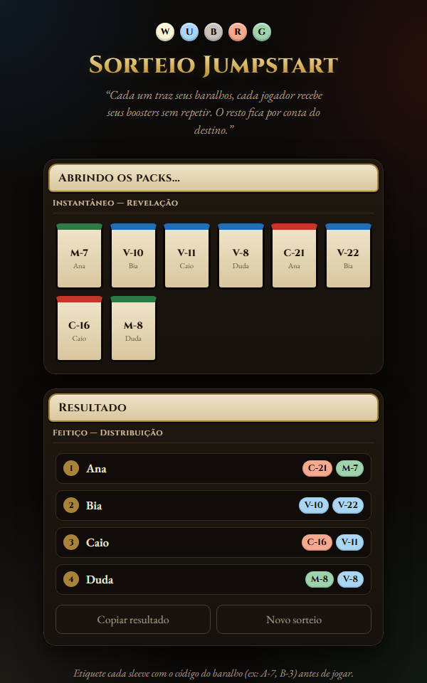
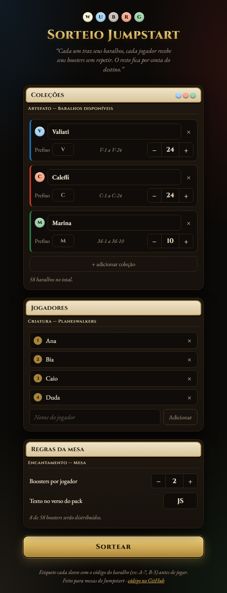

# 🃏 Sorteio Jumpstart

**Sorteie boosters de _Magic: The Gathering — Jumpstart_ entre os jogadores da mesa, sem repetir.**

---

## ✨ O que faz

Cada pessoa traz sua coleção de baralhos Jumpstart, numerados com um prefixo (ex: `V-1`, `V-2`… `C-1`, `C-2`…).
O app embaralha tudo e distribui os boosters entre os jogadores, em rodadas, sem nunca repetir um baralho.

- 🎴 **Quantas coleções quiser**, cada uma com nome, prefixo, cor de mana e quantidade
- 🧙 **Jogadores** ilimitados e **boosters por jogador** configuráveis
- ✍️ **Título editável** (clique nele) e texto personalizado no verso dos packs
- 🔮 **Animação de abertura** com o verso clássico das cartas
- 📋 **Copiar resultado** pronto para colar no WhatsApp
- 💾 Tudo fica **salvo no navegador**: na próxima partida é só abrir e sortear
- 🎲 Embaralhamento com `crypto.getRandomValues` (Fisher–Yates)

## 🚀 Como usar

**Online:** abra o link do GitHub Pages do repositório.

**Offline:** baixe o [`index.html`](index.html) e abra no navegador. É um arquivo só, sem instalação e sem dependências.

1. Em **Coleções**, cadastre os donos dos baralhos e a quantidade de cada um.
   Clique no símbolo de mana para trocar a cor.
2. Em **Jogadores**, adicione quem vai jogar.
3. Ajuste os **boosters por jogador** e clique em **Sortear**.
4. Etiquete cada sleeve com o código do baralho (ex: `V-7`) antes de jogar.

## 🌐 Publicar no GitHub Pages

1. No repositório, vá em **Settings → Pages**.
2. Em **Source**, escolha **Deploy from a branch**, depois a branch `main` e a pasta `/ (root)`.
3. Em alguns segundos o app estará em `https://<seu-usuario>.github.io/<nome-do-repo>/`.

## 📜 Licença

[MIT](LICENSE). Use, modifique e compartilhe à vontade.

Projeto de fã, sem afiliação com a Wizards of the Coast. Magic: The Gathering é marca registrada da Wizards of the Coast LLC.
